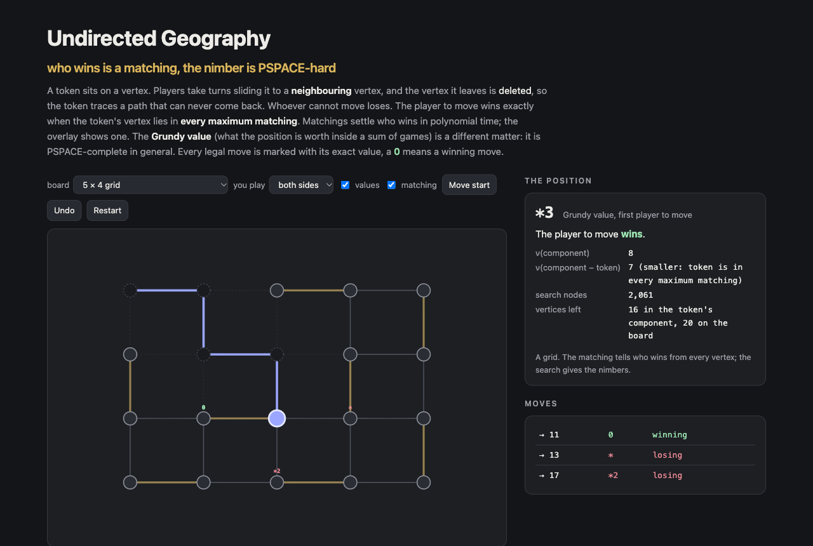

# Undirected Geography

Undirected Vertex Geography in the browser. A token sits on a vertex of a graph. Players take turns sliding it to a neighbouring vertex, and the vertex it leaves is deleted. **Whoever cannot move loses.**

Two questions get two very different answers:

- **Who wins?** The player to move wins exactly when the token's vertex lies in *every* maximum matching (Fraenkel, Scheinerman and Ullman, 1993). That takes two runs of Edmonds' blossom algorithm, and the demo draws the matching it uses.
- **What is the position worth?** The Grundy value, which you need for sums of games, is PSPACE-complete to compute (Burke, Ferland and Teng, FOCS 2021). The exception is maximum degree 3, where their branch-and-bound needs only winnability tests. The demo computes it by exact search and marks every legal move with its value; **0** marks a winning move.



## Run it

```sh
npm install
npm run dev        # http://localhost:5173/portfolio/undirected-geography/
npm test           # 15 tests
npm run build      # static site in dist/
```

## How it works

- `src/geography.ts`: the rules and three solvers. `Solver.grundy` is a memoised search keyed by the token and its component, since nothing outside the component matters. `wins` and `winningMoves` apply the matching criterion: deleting the token's vertex lowers the matching number ν. `maximumMatching` is Edmonds' blossom algorithm, O(V³). `Solver.branchAndBound` is the degree-3 algorithm from Burke–Ferland–Teng.
- `src/constructions.ts`: the paper's positions written out vertex by vertex: the trees t(k), the reduction from directed Geography with its 10-vertex edge gadget and prelude, and the Section 5 construction of a position worth *n. The construction can be built exactly as Algorithm 1 prints it, as the figures draw it, or anywhere in between.
- `src/presets.ts`, `src/main.ts`: the boards and the demo.
- `tools/graphs.mts`: every connected graph up to n vertices, built by vertex extension and deduplicated with an exact canonical form. The counts match OEIS A001349 (261,080 at n = 9).

## Checked against the literature

```sh
node tools/verify.mts 9          # the paper's claims → runs/literature.json
node tools/sweep.mts 9           # every connected graph ≤ 9 vertices, every start → runs/sweep.json
node tools/smallest.mts 5 10 120 # local search for a *5 position on 10 vertices → runs/smallest.jsonl
```

- **[BFT21]** K. W. Burke, M. Ferland, S.-H. Teng, *Winning the War by (Strategically) Losing Battles: Settling the Complexity of Grundy-Values in Undirected Geography*, FOCS 2021, arXiv:2106.02114. Read from the TeX source.
- **[FSU93]** A. S. Fraenkel, E. R. Scheinerman, D. Ullman, *Undirected edge geography*, Theoret. Comput. Sci. 112 (1993), as restated in [BFT21].

The one disagreement is Algorithm 1, the formal listing of the high-nimber construction. Built exactly as printed, the token on N_n is worth 0, \*, \*2, \*, … instead of \*n. The listing never adds three things that the figures and lemmas use: the edges N_i–M_i and N_i–P_i (i ≥ 5), the edge N_4–R_4, and a \*3 tree on N_4. With all three the value is \*n for n = 4…9, and removing any one breaks it (table below). The construction as drawn has 5n² − 15n − 4 vertices.

The tables below are generated by `node tools/report.mts` from `runs/`.

<!-- results:start -->
### The paper

16 of 17 items agree. Failing:

- `alg-1`: n=4: 0, n=5: \*, n=6: \*2, n=7: \*, n=8: \*2, n=9: \*

The high-nimber construction, value of the token on N_n by variant:

| variant | n=4 | n=5 | n=6 | n=7 | n=8 | n=9 |
|---|---:|---:|---:|---:|---:|---:|
| as drawn (figures) | \*4 | \*5 | \*6 | \*7 | \*8 | \*9 |
| as printed (Algorithm 1) | 0 | \* | \*2 | \* | \*2 | \* |
| Alg. 1 + N_i–M_i, N_i–P_i | 0 | \* | \*2 | \* | \*2 | \* |
| Alg. 1 + N_4–R_4 | \*3 | \* | \*2 | \* | \*2 | \* |
| Alg. 1 + *3 on N_4 | 0 | \* | \*2 | \* | \*2 | \* |
| drawn − N_4–R_4 | 0 | \* | \*2 | \* | \*2 | \* |
| drawn − *3 on N_4 | \*3 | \*4 | \*5 | \*6 | \*7 | \*8 |
| drawn − N_i–M_i, N_i–P_i | \*4 | \* | \*2 | \* | \*2 | \* |

Vertices (as drawn): 4: 16, 5: 46, 6: 86, 7: 136, 8: 196, 9: 266; search nodes: 8, 38, 321, 4,433, 81,611, 1,546,044.

All passing items:

- `obs-tree`: t(8): 256 vertices, deg 8, \*8; t(9): 512 vertices, deg 9, \*9; t(10): 1024 vertices, deg 10, \*10
- `thm-reduction`: 1801 / 1801 positions (every digraph on ≤ 3 vertices, 400 random on 4; reduced graphs up to 88 vertices)
- `lem-wrong-way`: 2364 / 2364 gadgets; values seen: \*2, \*3
- `lem-correct-way`: 2364 / 2364 gadgets
- `cor-prelude`: 1801 / 1801
- `thm-bnb-random`: 200 / 200 random subcubic graphs, n = 12…28; n=12: 5.5 winnability tests vs 180 search nodes; n=16: 5.3 winnability tests vs 573 search nodes; n=20: 5.6 winnability tests vs 2042 search nodes; n=24: 5.3 winnability tests vs 5805 search nodes; n=28: 5.5 winnability tests vs 16887 search nodes
- `cor-dual-triangulation`: cube \* (6 tests, 73 nodes); Petersen \* (6 tests, 184 nodes); dodecahedron \* (6 tests, 4390 nodes)
- `fsu-play`: 162 / 162 random games (8–17 vertices, opponent random)
- `thm-constructability`: n=4: \*4, n=5: \*5, n=6: \*6, n=7: \*7, n=8: \*8, n=9: \*9
- `lem-grounded`: 80 / 80
- `lem-r-to-n`: 80 / 80
- `lem-skip2`: 64 / 64
- `lem-skip1`: 64 / 64
- `lem-not1or2`: 31 / 31
- `lem-parity`: 49 / 49
- `thm-induction`: 31 / 31

### Every connected graph up to 9 vertices

| n | graphs | (graph, start) pairs | value 0 | value \* | value \*2 | value \*3 | value \*4 | FSU mismatches | subcubic starts | B&B mismatches | max tests |
|---:|---:|---:|---:|---:|---:|---:|---:|---:|---:|---:|---:|
| 1 | 1 | 1 | 1 |  |  |  |  | 0 | 1 | 0 | 0 |
| 2 | 1 | 2 |  | 2 |  |  |  | 0 | 2 | 0 | 1 |
| 3 | 2 | 6 | 5 | 1 |  |  |  | 0 | 6 | 0 | 2 |
| 4 | 6 | 24 | 3 | 14 | 7 |  |  | 0 | 24 | 0 | 6 |
| 5 | 21 | 105 | 83 | 11 | 11 |  |  | 0 | 50 | 0 | 9 |
| 6 | 112 | 672 | 70 | 424 | 156 | 22 |  | 0 | 174 | 0 | 8 |
| 7 | 853 | 5,971 | 4,898 | 667 | 372 | 34 |  | 0 | 448 | 0 | 13 |
| 8 | 11,117 | 88,936 | 4,357 | 59,405 | 18,880 | 5,854 | 440 | 0 | 1,552 | 0 | 12 |
| 9 | 261,080 | 2,349,720 | 2,155,288 | 98,997 | 67,971 | 26,483 | 981 | 0 | 4,779 | 0 | 17 |

Total: 273,193 graphs, 2,445,437 (graph, start) pairs, 0 exceptions to the matching theorem; 7,036 subcubic starts, 0 branch-and-bound mismatches.

**Fewest vertices for a position worth \*k:**

| k | exact (sweep) | found by local search |
|---:|---:|---:|
| 0 | 1 |  |
| 1 | 2 |  |
| 2 | 4 |  |
| 3 | 6 |  |
| 4 | 8 | 8 |
| 5 | 10 (none ≤ 9) | 10 |
| 6 | > 9 | 12, 11 (none in 240 s) |
| 7 | > 9 | 14, 13 (none in 150 s) |
| 8 | > 9 | 16 (none in 319 s) |

A tree needs 2^k vertices (its root needs subtrees worth 0, …, k−1).
<!-- results:end -->

## License

MIT
